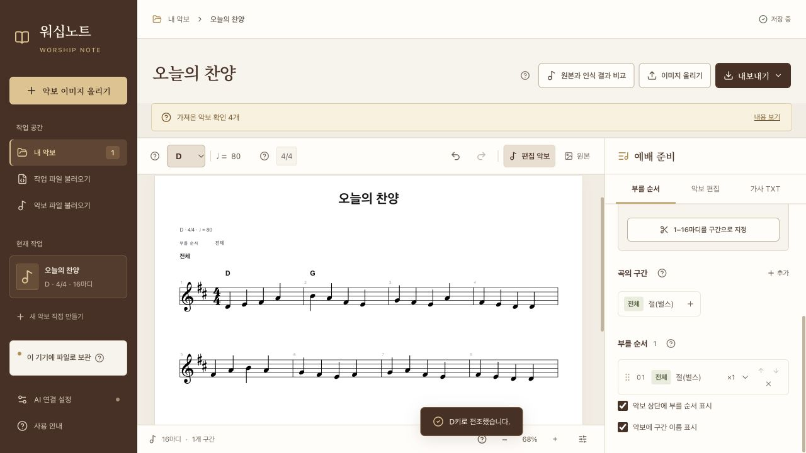

# 워십노트 · Worship Note

PNG·JPG 악보를 읽고, 전조하고, 절·후렴과 부를 순서를 정리하는 **개인용 로컬 악보 앱**입니다. 한국 교회의 예배 준비를 돕기 위한 오픈소스 시험판입니다. 기본 기능은 무료이며 AI 계정이나 API 키 없이 사용할 수 있습니다.

`[Mac 시험판 다운로드](https://github.com/Harkamont/worship-note/releases) · [화면별 사용 안내](docs/USER_GUIDE.md) · [그림 안내서 PDF](https://github.com/Harkamont/worship-note/releases/download/v0.2.0-beta.6/WorshipNote-UserGuide-ko.pdf)`

1. 다운로드 페이지에서 **WorshipNote-0.2.0-beta.6-macOS-arm64.zip**을 받아 압축을 모두 풉니다.
2. 폴더 안의 **워십노트 시작.command**를 두 번 누릅니다. Python·Node를 따로 설치하지 않아도 됩니다.
3. 브라우저가 열리면 `악보 이미지 올리기 → 무료로 음표 읽기 (기본)`으로 시작합니다.

**지원 환경: Apple Silicon Mac · macOS 15 이상.** Apple 서명·공증 전 시험판입니다. 다른 기기에서 실행이 차단될 수 있으며, Windows 실행 파일은 아직 실기 검증하지 않았습니다. 실행이 차단되면 경고 내용과 운영체제 버전을 이슈로 알려 주세요. 보안을 해제하는 명령은 안내하지 않습니다.

## 한 곡으로 익혀 보세요

[연습용 악보 PNG](docs/images/practice-score.png)를 올리고 [10단계 사용 안내](docs/USER_GUIDE.md)를 따라 해 보세요. 앱을 위해 직접 만든 **오늘의 찬양**으로 이미지 인식부터 전조·구간 나누기·가사 입력·파일 저장·다시 열기까지 익힐 수 있습니다.

안내 화면의 코드는 무료 인식 후 **1마디 C·2마디 F를 직접 입력한 것**입니다. C키에서 D키로 전조하면 각각 D·G로 바뀝니다. 무료 인식이 코드를 자동으로 읽은 결과는 아닙니다.

- **음표 읽기:** PNG·JPG 파일, 끌어놓기, 이미지 붙여넣기. 무료 인식 결과는 원본과 비교합니다.
- **악보 편집:** 키를 바꾸고 음표·코드·기본 가사를 직접 고칩니다. 가사는 구간별로 한 번에 입력한 뒤 배치를 확인하고 적용할 수 있습니다.
- **예배 준비:** 마디를 1절·후렴·브릿지로 나누고, 부를 순서와 반복 횟수를 정합니다.
- **파일 저장:** 악보 PNG, 송폼에 맞춘 가사 TXT, 편집용 MusicXML, 작업 백업 JSON을 저장합니다.

**무료 음표 인식은 가사·코드를 자동으로 붙이지 않습니다.** 직접 입력하거나 선택 사항인 유료 AI로 보완하세요. Mac의 무료 글자 읽기는 TXT 초안을 만드는 별도 도구로, 가사나 코드를 음표에 자동 배치하지 않습니다.

무료 글자 읽기는 한 변 2,500픽셀·400만 화소 이하 이미지에서 사용할 수 있습니다. 큰 연습용 PNG에서는 이 버튼이 비활성화될 수 있으며, 무료 음표 읽기와 직접 가사 입력은 계속 사용할 수 있습니다.

## 어떤 파일을 저장하나요?

| 파일 | 용도 | 들어가는 내용 |
| --- | --- | --- |
| PNG | 찬양팀에 악보 전달 | 구간별 악보를 한 번씩 표시하고, 선택하면 상단에 부를 순서를 적습니다. |
| TXT | 자막용 가사 전달 | 선택한 절의 가사를 부를 순서와 반복 횟수에 맞춰 저장합니다. |
| MusicXML | 다른 악보 프로그램에서 편집 | 음표·가사·코드와 부를 순서·반복을 반영합니다. |
| JSON | 다음 작업·이동·백업 | 원본 이미지, 편집한 악보, 송폼, 보관 중인 인식 결과를 함께 저장합니다. |

설치형 앱은 현재 작업을 이 컴퓨터의 앱 전용 폴더에 자동 저장합니다. 다른 곡을 시작하거나 컴퓨터를 옮기기 전에는 `내보내기 → 작업 파일 보관 (JSON)`을 선택하세요. **작업 파일 불러오기**로 다시 열 수 있습니다. 현재 작업은 한 곡이며, 여러 곡을 관리할 때는 곡마다 JSON 파일을 보관하세요.

앱을 종료할 때는 함께 열린 실행 창을 닫습니다. 브라우저 탭만 닫으면 앱은 계속 실행됩니다.

## 지금 가능한 것과 한계

| 항목 | 현재 범위 |
| --- | --- |
| 이미지 입력 | PNG·JPG 한 장, 10MB 이하. 여러 페이지 자동 병합은 제공하지 않습니다. |
| 악보 가져오기 | MusicXML·XML·MXL. 여러 성부의 원본은 보관하고 편집할 멜로디를 고를 수 있습니다. |
| 편집 | 단선율·한 조성·한 박자 중심. 온·2분·4분·8분·16분음표, 점 하나, 쉼표·붙임줄·코드를 지원합니다. |
| 못갖춘마디 | 짧은 첫 마디를 가져오고 실제 길이를 확인·변경합니다. 음표 길이를 자동으로 맞추지는 않습니다. |
| 4부 찬송가 | 남길 멜로디를 선택합니다. 소프라노 자동 선택의 정확성을 보장하지 않으며 없는 코드를 만들지는 않습니다. |
| 가사 | 기본 가사 입력·수정, 가져온 여러 절 보관·TXT 출력. 다른 절 전체를 편집하는 화면은 아직 없습니다. |
| 복잡한 기보 | 잇단음표·32분음표·복잡한 시간 이동 등은 편집기로 가져오지 못할 수 있습니다. 원본 XML은 보관합니다. |
| 인식 정확도 | 자동 검사는 파일 구성·박자 등을 확인합니다. 음높이·가사·코드의 원본 일치율을 보장하지 않습니다. |

빽빽한 마디는 필요한 폭을 확보해 줄을 바꿉니다. 화면 확대·축소와 다운로드 배치는 별개이며, 출력은 **악보 편집 → 출력 모양**에서 조절합니다.

## AI는 원할 때만 연결하세요

**AI 연결 설정** 화면에서 본인의 서비스와 모델을 고르고 키를 입력합니다. **API 키는 앱 화면에만 입력하고, 채팅·이슈·README에 붙여넣지 마세요. 설정 JSON이나 앱 설정 폴더도 공유하지 마세요.** 악보를 보관하는 작업 파일 JSON과 AI 설정 파일은 서로 다릅니다.

키를 저장하는 것만으로 유료 요청을 보내지는 않습니다. ‘유료’ 버튼을 직접 누르면 이미지가 선택한 서비스로 전송됩니다. 가사·코드 추가, 악보 전체 읽기, 선택한 1~4마디 보완을 선택할 수 있으며 실패·취소한 요청에도 요금이 발생할 수 있습니다. 사용료 정보가 없다는 표시는 무료라는 뜻이 아닙니다. 자동 유료 재시도는 하지 않습니다.

## 문제가 생기면

- **인식이 다르게 나옴:** 원본과 비교해 고치거나 검토용으로 열어 수정합니다. 복잡한 악보는 원본 XML을 다른 악보 앱에서 확인하세요.
- **TXT 버튼을 누를 수 없음:** **가사 TXT → 가사 한 번에 넣기**에서 가사를 입력하고 미리 본 뒤 적용하세요.
- **저장 실패:** 바로 작업 파일 JSON을 다운로드합니다. 오류가 해결되기 전에 앱 데이터를 지우지 마세요.
- **실행·연결 오류:** 기존 실행 창을 닫고 압축을 모두 푼 폴더에서 다시 실행합니다. 자세한 안내는 [사용 안내](docs/USER_GUIDE.md)를 참고하세요.

[GitHub 이슈](https://github.com/Harkamont/worship-note/issues)에 운영체제, 재현 순서, 오류 문구를 적어 주세요. API 키·설정 파일·개인 악보는 첨부하지 마세요. 악보 오류를 보여 줄 때는 공유 가능한 짧은 예제를 사용해 주세요.

## 개발·라이선스

소스에서 실행·검사·배포 파일을 만드는 방법은 [데스크톱 빌드 안내](desktop/BUILDING.md)에 있습니다. 웹 편집기는 TypeScript, 로컬 실행기는 Python을 사용하며 운영체제마다 별도 빌드·검증이 필요합니다.

이번 시험판에서 직접 확인한 표본, 처리 시간, 파일 저장 결과와 측정하지 않은 항목은 [배포 검증 기록](docs/release-validation.md)에 정리했습니다. 마디·음표 개수와 인식 정확도는 구분합니다.

[AGPL-3.0](LICENSE). HOMR 코드·모델, 악보 렌더러, 글꼴과 의존성 고지는 [THIRD_PARTY_NOTICES.md](THIRD_PARTY_NOTICES.md)를 참고하세요. 공개 연습 예제는 앱을 위해 직접 만들었으며, 사용자가 제공한 원본 악보·가사·키·개인 작업 파일은 배포하지 않습니다. 프로그램의 라이선스와 악보의 복제·배포 권한은 별개입니다.

기여하려면 [기여 안내](CONTRIBUTING.md)를 읽어 주세요. 초기 연구·측정 과정은 [개발 기록](docs/development-history.md)에 정리했습니다.
