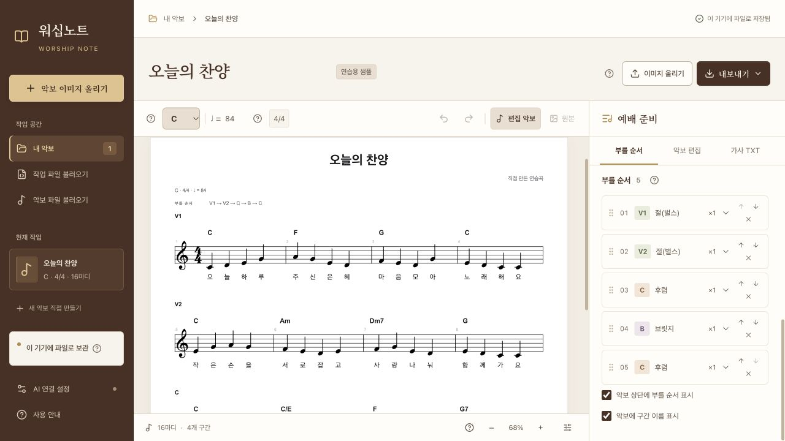
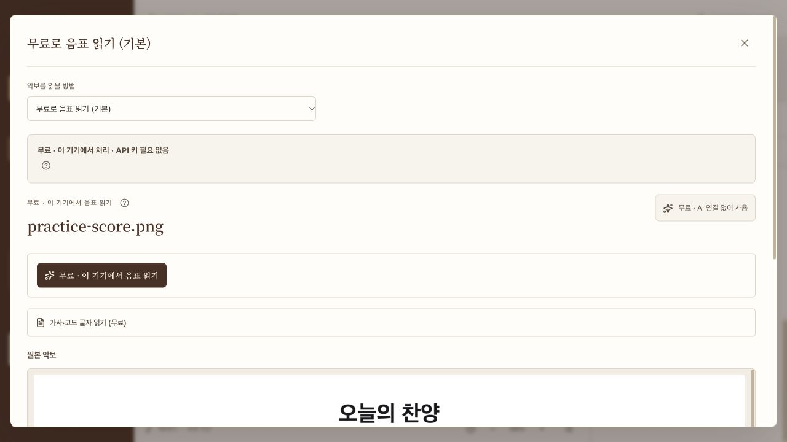
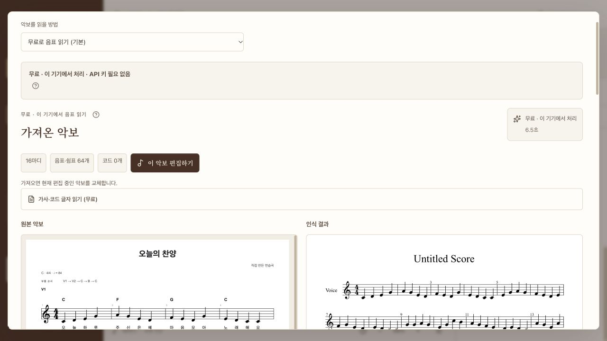
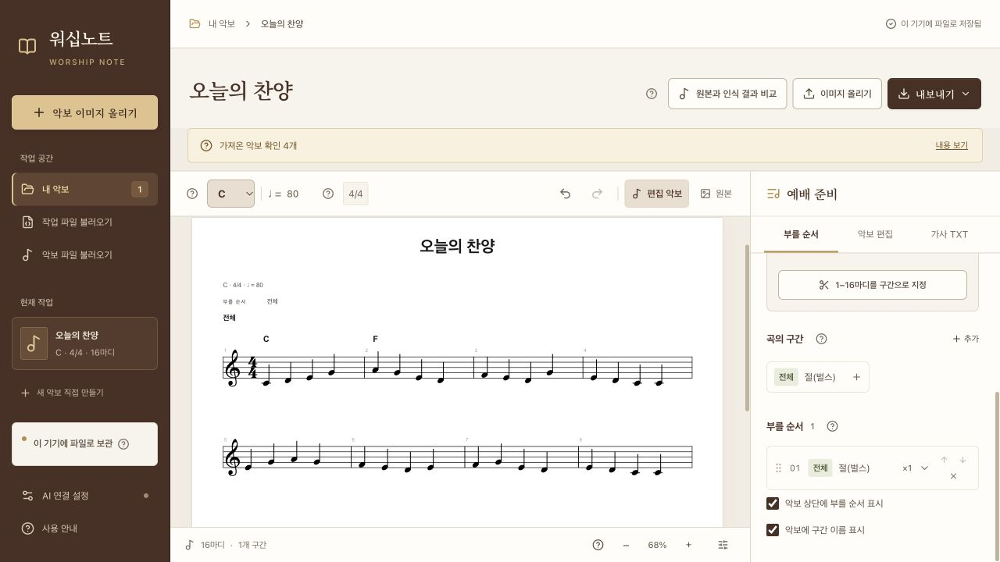
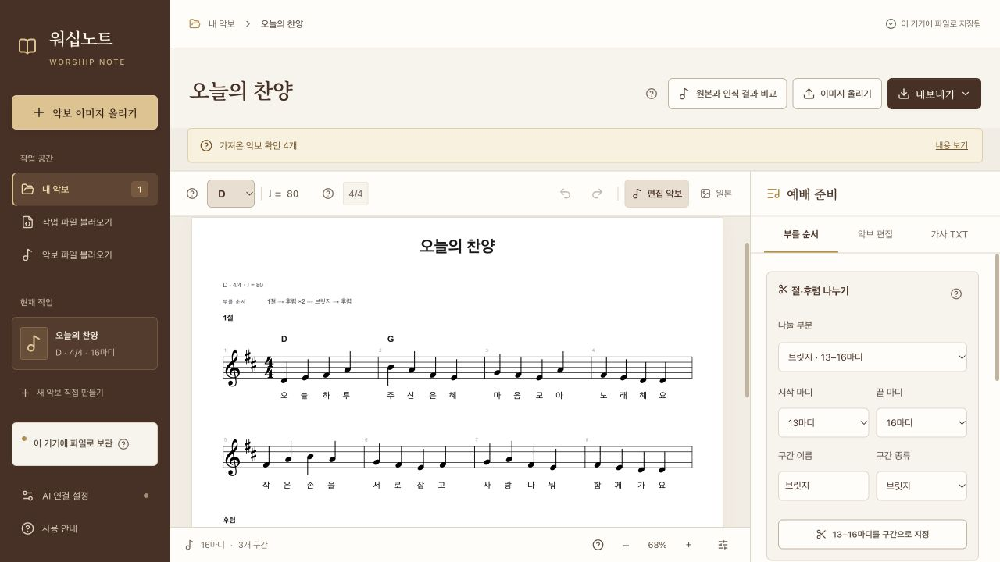
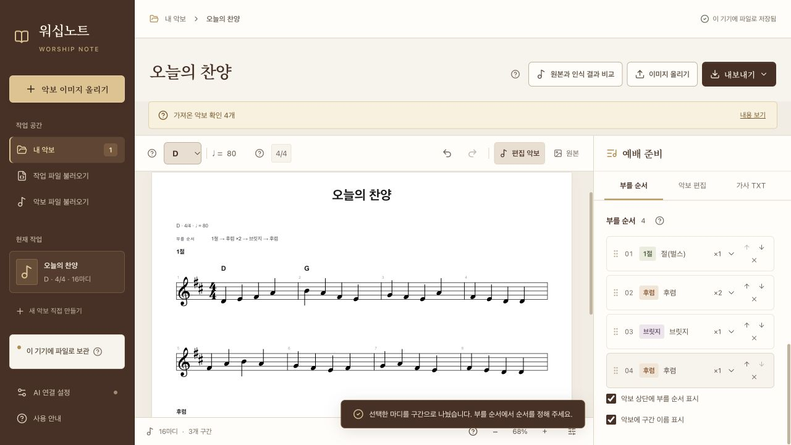
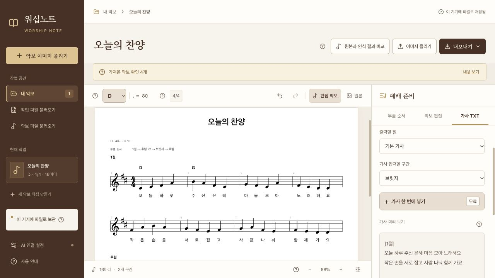
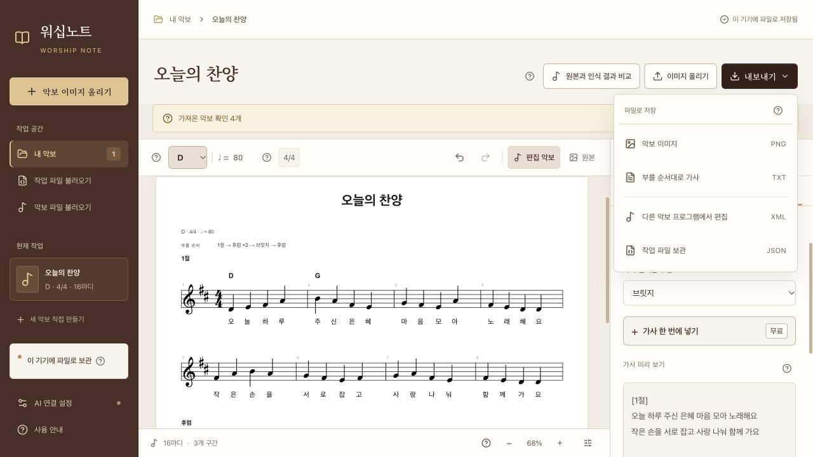
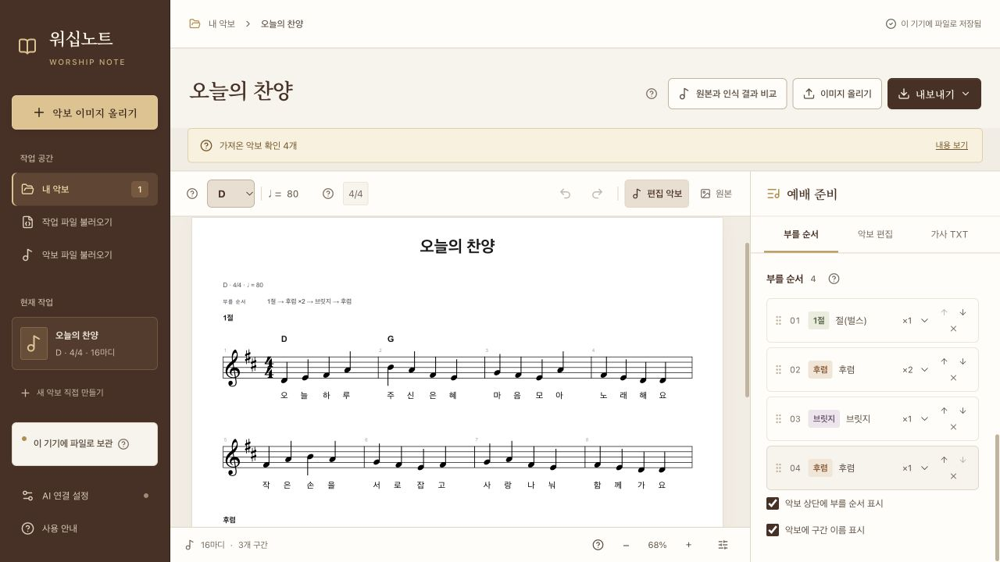

# 워십노트 처음 사용 안내

받은 악보를 올리고, 우리 찬양팀의 키로 바꾸고, 예배 순서에 맞는 악보와 가사를 저장해 보세요. 이 안내서는 **무료 기본 기능**으로 진행합니다. AI 연결이나 API 키가 필요하지 않습니다.

**대상:** Apple Silicon Mac · macOS 15 이상용 시험판. Apple 서명·공증 전이며 Windows 실행 파일은 아직 실기 검증하지 않았습니다.

[Mac 시험판 다운로드](https://github.com/Harkamont/worship-note/releases) · [인쇄용으로도 열 수 있는 HTML 안내서](USER_GUIDE.html) · [연습용 악보 PNG](images/practice-score.png)

연습 곡 **오늘의 찬양**은 앱을 위해 직접 만든 16마디 악보입니다. 이 파일을 준비하고 아래 순서대로 따라 하세요. 인식 결과의 마디·음표가 원본과 다르면 먼저 확인하고 고칩니다. 이 안내는 모든 악보의 인식 정확도를 보장하는 자료가 아닙니다.

## 1. 워십노트 열기

Mac 배포 ZIP의 압축을 모두 풀고 폴더 안의 **워십노트 시작.command**를 두 번 누릅니다. 준비가 끝나면 브라우저가 열립니다. Python이나 Node를 따로 설치할 필요는 없습니다.

처음 보이는 연습곡에서는 마디를 누르거나 키를 바꾸어 볼 수 있습니다. 이 안내에서는 연습용 PNG를 다시 올려 이미지 인식부터 진행합니다. 이미 작업하던 곡이 있다면 **내보내기 → 작업 파일 보관 (JSON)**으로 먼저 보관하세요.



*왼쪽에서 악보를 올리고, 가운데에서 확인하며, 오른쪽에서 구간과 부를 순서를 정합니다.*

## 2. 연습용 악보 이미지 올리기

[연습용 악보 PNG](images/practice-score.png)를 저장한 뒤 왼쪽의 **악보 이미지 올리기**를 눌러 고릅니다. PNG·JPG 파일을 화면으로 끌어다 놓아도 됩니다. 이미지를 복사했다면 입력 칸 밖을 누르고 **⌘V**로 붙여넣을 수 있습니다.

**악보를 읽을 방법**은 **무료로 음표 읽기 (기본)**으로 둡니다. 원본이 선명하고 빠진 부분이 없는지 확인합니다. 이미지 한 장은 10MB 이하이며, 여러 장을 한 곡으로 합치는 기능은 현재 제공하지 않습니다.



*기본 무료 방식은 이 컴퓨터에서 음표를 읽습니다. 외부 AI 연결이 필요하지 않습니다.*

## 3. 음표를 읽고 원본과 비교하기

**무료 · 이 기기에서 음표 읽기**를 누릅니다. 결과가 나타나면 원본과 인식 악보를 마디별로 비교하세요. 음높이·쉼표·붙임줄·조표와 첫 마디의 길이를 확인합니다.

**이번 연습 결과:** 무료 음표 읽기는 6.5초가 걸렸고 16마디·음표와 쉼표 64개·코드 0개를 반환했습니다. API 사용료는 0입니다. 이 개수만으로 모든 음표가 원본과 맞았다고 판단할 수는 없습니다.

무료 음표 읽기는 가사와 코드를 자동으로 붙이지 않습니다. 결과의 코드가 0개이거나 가사가 비어 있어도 가사까지 읽었다고 해석하지 마세요. 이 안내에서는 뒤에서 가사를 직접 넣습니다.

화면의 **가사·코드 글자 읽기 (무료)**는 별도 도구입니다. 열고 버튼을 눌러야 읽으며, 글자를 고쳐 TXT로 저장할 수 있습니다. 글자를 음표 아래에 붙이거나 코드를 박자에 맞춰 넣는 기능은 아닙니다. 한 변 2,500픽셀·400만 화소 이하 이미지에서 사용할 수 있어, 이 안내서의 큰 연습용 PNG에서는 버튼이 비활성화됩니다. 이 경우에도 무료 음표 읽기와 직접 가사 입력은 계속할 수 있습니다.



*자동 검사는 파일 구성과 박자 등을 확인합니다. 원본과 같은 음높이인지는 직접 대조하세요.*

## 4. 편집기로 가져오기

일반 멜로디 악보는 결과 상단의 **이 악보 편집하기**를 누릅니다. 화면 아래의 **편집기로 가져오기**도 같은 결과를 가져옵니다. 현재 편집 중인 곡은 이 악보로 바뀝니다.

전조할 코드도 직접 넣어 봅니다. 악보에서 **1마디를 누른 뒤 악보 편집 탭의 코드 → 추가**를 누르고, 박 위치 **1**에 코드 **C**를 입력합니다. 같은 방법으로 **2마디에 F**를 넣습니다. 아래 화면에 표시된 두 코드는 이렇게 직접 넣었으며, 무료 인식이 읽은 코드는 아닙니다.

4부 찬송가라면 **4부 찬송가를 멜로디 악보로**에서 남길 멜로디를 고르고 **멜로디 악보 만들기 → 멜로디 편집하기**를 누릅니다. 자동 선택이 원본의 주 멜로디와 다르면 다른 성부를 골라 비교하세요. 없는 코드를 새로 만들지는 않습니다.

박자 확인 사항이 남으면 **검토용으로 열고 고치기**가 제공될 수 있습니다. 표시된 마디를 고친 뒤 사용하세요. 지원하지 않는 음표 구성 때문에 가져올 수 없을 때는 원본 XML을 저장해 다른 악보 앱에서 확인합니다.



*마디를 눌러 코드 C·F를 직접 넣은 화면입니다. 원본 이미지는 ‘원본’ 탭에서 다시 볼 수 있습니다.*

## 5. C키를 D키로 전조하기

편집 화면 위쪽에서 **현재 키(C)가 표시된 선택 상자**를 눌러 **D**를 고릅니다. 편집 악보의 멜로디와 입력된 코드가 함께 전조되어 앞에서 넣은 **C·F는 D·G**로 바뀝니다. 무료 결과에 코드가 없다면 새 코드가 생기지는 않습니다.

사진인 **원본**은 바뀌지 않습니다. **편집 악보**에서 새 조표와 음높이를 확인하세요. 잘못 바꿨다면 **실행 취소**를 누릅니다.


*직접 넣은 두 코드도 D·G로 함께 바뀝니다. 인식 오류를 고치는 기능과 전조는 별개입니다.*

## 6. 1절·후렴·브릿지로 나누기

오른쪽 **예배 준비 → 부를 순서**에서 **절·후렴 나누기**를 사용합니다. **나눌 부분**에서 작업할 구간을 고르고 다음처럼 나눕니다.

| 시작–끝 마디 | 구간 이름 | 구간 종류 |
| --- | --- | --- |
| 1–8 | 1절 | 절 (벌스) |
| 9–12 | 후렴 | 후렴 |
| 13–16 | 브릿지 | 브릿지 |

먼저 전체 구간의 1–8마디를 고른 뒤 이름·종류를 입력하고 **1–8마디를 구간으로 지정**을 누릅니다. 다음에는 **나눌 부분**에서 남은 9–16마디를 골라 9–12마디를 후렴으로 지정합니다. 마지막 13–16마디는 브릿지로 지정합니다.

이 도구의 마디 번호는 **편집 악보 전체의 첫 마디부터** 셉니다. 구간 이름 옆에 표시된 범위를 확인하세요. 나누고 남은 마디는 지워지지 않습니다. 붙임줄로 이어진 마디는 함께 포함해 나누어야 합니다.



*기존 마디를 나눌 때는 이 도구를 사용합니다. ‘곡의 구간’ 옆 ‘추가’는 음표를 새로 입력할 빈 구간을 만드는 기능입니다.*

## 7. 부를 순서와 반복 횟수 정하기

**곡의 구간**에서 이름을 누르면 **부를 순서** 끝에 추가됩니다. 구간을 나눌 때 기존 순서도 함께 나뉘므로, 이미 들어 있는 행을 먼저 확인하세요. 각 행 오른쪽 화살표로 순서를 바꾸고 필요 없는 행은 삭제합니다. 순서에서 삭제해도 해당 구간의 음표는 남습니다.

이번 예제는 **1절 → 후렴 ×2 → 브릿지 → 후렴**으로 정합니다. 후렴의 반복 상자는 **×2**, 나머지는 **×1**로 둡니다. 같은 후렴을 마지막에 다시 넣으려면 **곡의 구간 → 후렴**을 한 번 더 누릅니다.

**악보 상단에 부를 순서 표시**, **악보에 구간 이름 표시**를 켜면 출력할 악보에도 이름과 순서가 보입니다.



*PNG는 구간별 악보를 한 번씩 표시하고 상단에 부를 순서를 적습니다. TXT와 MusicXML은 부를 순서와 반복을 반영해 내용을 전개합니다.*

## 8. 가사를 한 번에 넣고 TXT 확인하기

오른쪽 **가사 TXT** 탭에서 **가사 입력할 구간 → 1절**을 고르고 **가사 한 번에 넣기**를 엽니다. 다음 가사를 넣습니다.

```text
오늘 하루 주신 은혜 마음 모아 노래해요
작은 손을 서로 잡고 사랑 나눠 함께 가요
```

**가사 배치 미리보기**를 누르고 어느 음표에 어떤 글자가 들어가는지 확인한 뒤 **확인한 가사 적용**을 누릅니다. 이후 후렴과 브릿지도 각각 골라 같은 방법으로 넣습니다.

**후렴**

```text
감사해요 나의 주님 밝은 노래 주께 드려
```

**브릿지**

```text
비가 와도 힘을 내요 주의 말씀 따라 살래
```

한글은 한 음절씩 배치하며 쉼표와 붙임줄 뒤의 음표는 건너뜁니다. 같은 글자를 여러 음으로 늘여 부른다면 추가 음표마다 공백으로 구분한 **`-`**를 넣습니다. 예: **`주 - 님`**. 음표 수와 맞지 않으면 적용할 수 없으므로 안내를 확인하고 입력이나 악보를 고치세요. 이 기능은 기본 가사만 바꾸며 다른 절의 가사는 보존합니다.

아래 **가사 미리 보기**에서 부를 순서와 반복이 맞는지 살펴봅니다. 필요한 경우 **출력할 절**을 바꾸고 **구간 이름 포함**을 켭니다. **TXT 다운로드**로 저장하거나 **복사**로 자막 프로그램에 붙여넣습니다. 가사가 없으면 TXT 저장 버튼은 활성화되지 않습니다.



*가사 대신 길이만 나타내는 늘임 표시는 TXT에서 제외합니다. 띄어쓰기와 줄바꿈, 부르는 위치는 직접 확인하세요.*

## 9. 악보·가사·작업 파일 저장하기

위쪽 **편집 악보** 탭을 선택하고 **내보내기**를 누릅니다. 먼저 악보 PNG와 작업 JSON을 저장하세요. 가사 TXT는 같은 메뉴 또는 **가사 TXT → TXT 다운로드**에서 저장할 수 있습니다.

| 메뉴 | 파일 | 사용할 때 |
| --- | --- | --- |
| 악보 이미지 | PNG | 찬양팀에 지금 편집한 악보를 전달합니다. |
| 부를 순서대로 가사 | TXT | 선택한 절과 순서·반복을 반영해 자막용 가사를 전달합니다. |
| 다른 악보 프로그램에서 편집 | XML | MuseScore 등에서 음표·가사·코드를 이어서 편집합니다. |
| 작업 파일 보관 | JSON | 원본·편집 악보·송폼·보관된 인식 결과를 백업합니다. |

PNG가 빽빽하면 **악보 편집 → 출력 모양**에서 **한 줄의 최대 마디**와 **가사 글자 크기**를 바꿉니다. 화면 아래 확대·축소는 화면 크기만 바꾸며 다운로드 배치는 바꾸지 않습니다. 저장한 PNG와 TXT를 직접 열어 사용 전에 확인하세요.



*다음에 이어서 작업하려면 JSON도 함께 보관하세요. PNG나 XML만으로는 이 앱의 작업 전체를 복원할 수 없습니다.*

## 10. 작업 파일로 다시 열기

왼쪽 **작업 파일 불러오기**를 누르고 저장한 JSON을 고릅니다. 다른 곡을 작업 중이라면 그 곡도 먼저 JSON으로 보관하세요. 파일을 열면 현재 작업이 바뀝니다.

다시 연 뒤 제목, 키, 구간 이름, 부를 순서, 가사를 확인합니다. **원본과 인식 결과 비교**에서는 함께 보관한 인식 내용을 볼 수 있습니다. 기존 AI 설정은 악보 작업 파일과 별도로 관리합니다.



*설치형 앱은 현재 작업을 이 기기에 자동 저장합니다. 별도 백업이나 다른 컴퓨터로의 이동에는 JSON 파일을 사용하세요.*

## AI를 추가로 사용하려면

기본 작업에는 필요하지 않습니다. 원할 때 **AI 연결 설정**에서 서비스·모델·본인의 키를 입력하세요. 키는 앱 화면에만 입력하고 채팅·GitHub 이슈·README에 붙여넣지 마세요. **설정 JSON과 앱 설정 폴더를 공유하지 마세요.** 작업 백업용 JSON과 AI 설정 파일은 서로 다릅니다.

키를 저장하는 것만으로 유료 요청을 보내지는 않습니다. ‘유료’라고 표시된 버튼을 누르면 이미지가 선택한 서비스로 전송됩니다. 무료 음표에 가사·코드를 추가하거나, 악보 전체를 다시 읽거나, 사용자가 고른 연속 1~4마디만 보완할 수 있습니다. 실패·취소한 요청에도 요금이 생길 수 있으며 사용료 정보가 없다는 표시는 무료라는 뜻이 아닙니다.

부분 AI는 잘못된 음표를 자동으로 모두 찾지 않습니다. 사용자가 고칠 마디와 원본 이미지의 같은 부분을 골라야 합니다. 미리 보기와 AI 요청은 별도이며 수정안은 확인한 뒤 적용합니다.

## 자주 막히는 부분

| 상황 | 해 볼 일 |
| --- | --- |
| Mac에서 실행이 차단됨 | 현재는 서명·공증 전 시험판입니다. 운영체제와 경고 문구를 이슈로 알려 주세요. 보안을 해제하는 명령을 사용하도록 안내하지 않습니다. |
| 앱이 이미 실행 중이라고 나옴 | 함께 열린 실행 창이 있는지 확인하고 닫은 뒤 다시 실행합니다. 브라우저 탭만 닫으면 앱은 계속 실행됩니다. |
| 음표 인식기를 시작하지 못함 | ZIP 전체를 다시 풀고 폴더 구성을 유지한 상태에서 시작합니다. 실행 중에 안의 파일을 옮기지 마세요. |
| 가사가 비어 있음 | 무료 음표 읽기는 가사를 붙이지 않습니다. ‘가사 한 번에 넣기’로 입력하거나 선택 사항인 유료 AI로 추가하세요. |
| 가사 적용 버튼을 누를 수 없음 | 가사 배치 미리보기를 먼저 확인합니다. 음표와 가사 단위 수가 맞는지, 늘임 표시가 필요한지 살펴보세요. |
| 다음 후렴을 나누기 어려움 | ‘나눌 부분’에서 남은 마디를 고른 뒤 전체 악보 기준 번호로 지정합니다. |
| 박자 확인 안내가 나옴 | 원본을 대조하세요. 못갖춘마디라면 ‘이 마디의 길이’를 먼저 확인하고 음표 길이의 합을 고칩니다. |
| 저장 실패가 표시됨 | 바로 ‘작업 파일 보관 (JSON)’을 다운로드합니다. 오류가 해결되기 전에 앱 데이터를 지우지 마세요. |

현재 편집기는 단선율·한 조성·한 박자를 중심으로 합니다. 잇단음표·32분음표·복잡한 시간 이동 등을 가져오지 못할 수 있으며, 원본 XML은 보관합니다. 가사와 코드를 포함해 원본과 정확히 같은지는 직접 확인해야 합니다.

문제가 계속되면 [GitHub 이슈](https://github.com/Harkamont/worship-note/issues)에 운영체제, 누른 버튼 순서, 오류 문구를 적어 주세요. 키·설정 파일·개인 악보는 첨부하지 마세요.

표본별 처리 시간과 파일 검사는 [배포 검증 기록](release-validation.md)에서 확인할 수 있습니다. 전체 음표·가사·코드의 원본 일치율은 아직 측정하지 않았습니다.
